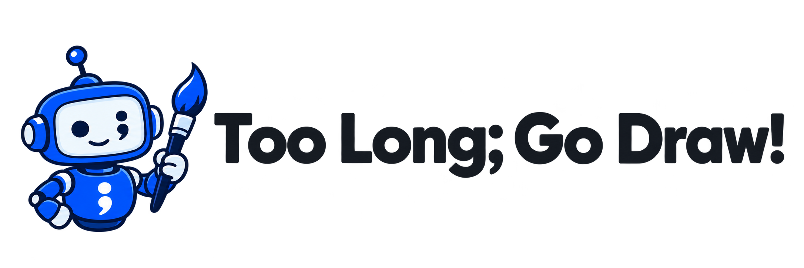
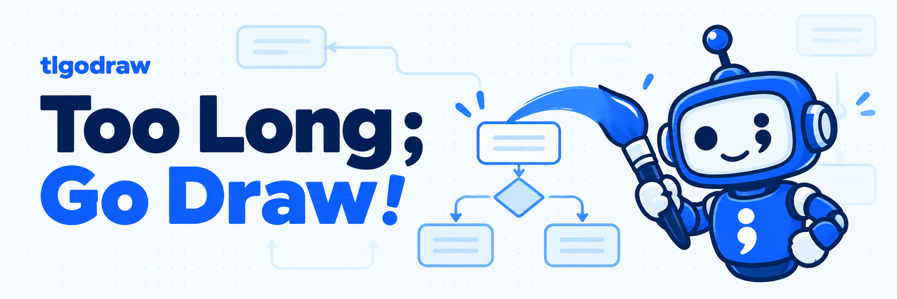

<a name="readme-top"></a>

<p align="center">
  <a href="https://tlgodraw.onrender.com">
  
  </a>
</p>

<div align="center">

**Too Long; Go Draw** は、AI を活用した作図ワークベンチです。自然言語で図を説明し、AI エージェントと協力しながら、ブラウザー上で Draw.io の図を作成・改善できます。

プロジェクトは、**Go/Gin** による API サービスと **React** フロントエンドで構成されています。デフォルトの AI ワークフローは、リクエストの分析、Draw.io XML の生成、結果のレビューを行ってから、ワークベンチに結果を返します。

[English](./README.md) · [简体中文](./README.zh-CN.md) · **日本語** · [公式サイト](https://tlgodraw.onrender.com) · [フィードバック](https://github.com/yydrowz3/tlgodraw/issues)

</div>

<p align="center">
  <a href="https://tlgodraw.onrender.com">
  
  </a>
</p>

<p align="center">
  <a href="https://tlgodraw.onrender.com">
  
  </a>
</p>

<p align="center">


</p>

<p align="center">


</p>

<div align="center">

<sup>Too Long; Go Draw!</sup>

</div>

## ✨ 主な機能

- 自然言語による図の生成。
- ブラウザー上での Draw.io の図の編集。
- AI による図の分析、生成、レビュー。
- 複数のローカル作図セッションとチャットセッション。
- ローカル環境でのセッションの永続化。
- OpenAI 互換 API の接続設定とエージェントワークフローのカスタマイズ。

## 📁 プロジェクト構成

```text
apps/
  api/       Go バックエンドサービス
  web/       React フロントエンドアプリケーション
```

API の設定は `apps/api/configs/application.yaml` に、エージェントワークフローの設定は `apps/api/configs/agent/draw.yaml` に保存されています。

## 🚀 デプロイ

### 必要な環境

- Go 1.27.1 または互換性のあるバージョン。
- Node.js と pnpm。
- AI による図の生成に使用する OpenAI 互換 API。
- デフォルトのローカル設定では、PostgreSQL と Redis は任意です。対応するアプリケーション機能で必要な場合にのみ有効にしてください。

### 設定

`apps/api` ディレクトリから起動すると、API はデフォルトで `configs/application.yaml` を読み込みます。次の環境変数も利用できます。

- `APP_CONFIG`：アプリケーションの YAML 設定ファイルのパス。
- `APP_ENV_FILE`：dotenv ファイルのパス。空の値を設定すると、dotenv の読み込みをスキップします。

デフォルトのエージェント設定では、次の環境変数が必要です。

- `OPENAI_BASE_URL`：OpenAI 互換 API のベース URL。
- `OPENAI_API_KEY`：設定した AI プロバイダーの API キー。

開発用の設定値は、`apps/api` にローカルの `.env` ファイルを作成して保存してください。実際の認証情報やその他の機密情報をコミットしないでください。

デフォルトの API アドレスは `http://localhost:8091` です。フロントエンドは `VITE_BASE_URL` から API のベース URL を読み込みます。設定例：

```dotenv
VITE_BASE_URL=http://localhost:8091
```

### ローカルでの実行

#### API の起動

リポジトリのルートディレクトリから実行します。

```bash
cd apps/api
go run ./cmd/server
```

サーバーはデフォルトで `:8091` をリッスンします。設定ファイルのパスを指定する場合：

```bash
go run ./cmd/server --env .env --config configs/application.yaml
```

#### Web アプリの起動

別のターミナルで実行します。

```bash
cd apps/web
pnpm install
pnpm dev
```

Vite が出力するローカル URL を開いてください。`VITE_BASE_URL` が起動中の API サービスを指していることを確認してください。

#### 開発時のチェック

`apps/api` ディレクトリで API のチェックを実行します。

```bash
go test ./...
go vet ./...
```

`apps/web` ディレクトリでフロントエンドのチェックを実行します。

```bash
pnpm lint
pnpm build
```

### API の概要

フロントエンドは、次の操作に API を使用します。

- `GET /query-ai-agent-config-list`：利用可能な AI エージェントの一覧を取得します。
- `POST /create_session`：AI セッションを作成します。
- `POST /chat`：メッセージを送信し、AI の応答を受け取ります。

リクエストが成功すると、API は共通のレスポンス形式で成功コード `0000` を返します。

## 🤝 コントリビューション

あらゆる形でのコントリビューションを歓迎します。コードの貢献に興味がある方は、GitHub の [Issues](https://github.com/yydrowz3/tlgodraw/issues) をご覧ください。

開発規約、ローカルでのチェック、コミットメッセージのルール、Pull Request の要件については、[CONTRIBUTING.md](CONTRIBUTING.md) をお読みください。

コミュニティの行動規範については [CODE_OF_CONDUCT.md](CODE_OF_CONDUCT.md) を、セキュリティ問題の報告方法については [SECURITY.md](SECURITY.md) をご覧ください。

> [!TIP]
>
> 私たちは、技術を軸とした交流の場をつくっています。知識の共有と意見交換を通じて互いに刺激を受け、協力して新しいものを生み出すことを目指しています。
>
> プロダクトデザインへのフィードバックや、ユーザー体験に関するご意見をぜひ直接お寄せください。皆さまの声が改善につながります。
>
> **主要メンテナー：** [@yydrowz3](https://github.com/yydrowz3)

## ❤️ スポンサー

どのようなご支援も、私たちの大きな力になります。一度のご寄付も、夜空を駆ける流星のように、私たちの歩みを明るく照らしてくれます。信頼と温かいご支援に感謝します。皆さまの応援が、目標へと進む道しるべです。

## 📄 ライセンス

本プロジェクトは `MIT License` の下で公開されています。詳細は [LICENSE](LICENSE) をご覧ください。

Copyright © 2026 [Feed To Go](https://github.com/yydrowz3/tlgodraw).

<div align="right">

[](#readme-top)

</div>

---

_エージェント開発を楽しみましょう！_
