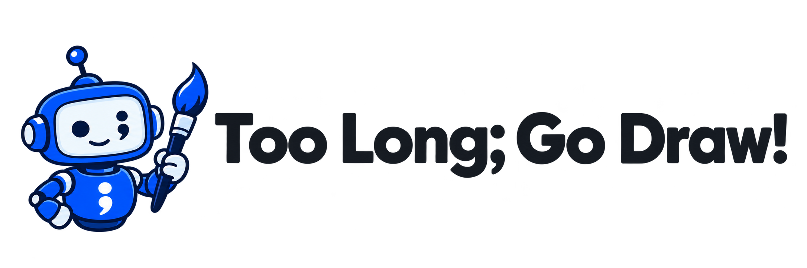
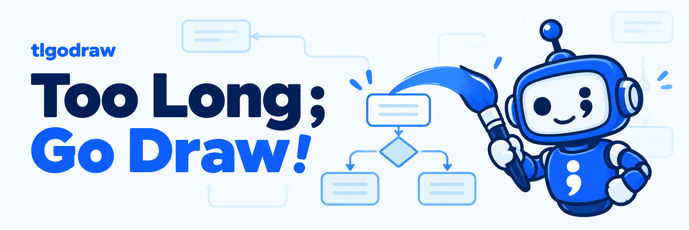

<a name="readme-top"></a>

<p align="center">
  <a href="https://tlgodraw.onrender.com">
  
  </a>
</p>

<div align="center">

**Too Long; Go Draw** is an AI-assisted diagramming workbench. Describe a diagram in
natural language, collaborate with an AI agent, and create or refine Draw.io
diagrams in the browser.

The project contains a **Go/Gin** API service and a **React** frontend. The default AI
workflow analyzes the request, generates Draw.io XML, and reviews the result
before returning it to the workbench.

**English** · [Chinese](./README.zh-CN.md) · [Japanese](./README.ja.md) · [Official Site](https://tlgodraw.onrender.com) · [Feedback](https://github.com/yydrowz3/tlgodraw/issues)

</div>

<p align="center">
  <a href="https://tlgodraw.onrender.com">
  
  </a>
</p>

<p align="center">
  <a href="https://tlgodraw.onrender.com">
  
  </a>
</p>

<p align="center">


</p>

<p align="center">


</p>

<div align="center">

<sup>Too Long; Go Draw!</sup>

</div>

## ✨ Features

- Natural-language diagram generation.
- Draw.io editing in the browser.
- AI-assisted diagram analysis, generation, and review.
- Multiple local drawing and chat sessions.
- Session persistence in local environment.
- Configurable OpenAI-compatible API settings and agent workflows.

## 📁 Project Structure

```text
apps/
  api/       Go backend service
  web/       React frontend application
```

The API configuration is stored in `apps/api/configs/application.yaml`, and the agent workflow is configured in `apps/api/configs/agent/draw.yaml`.

## 🚀 Deployment

### Requirements

- Go 1.27.1 or a compatible version.
- Node.js and pnpm.
- An OpenAI-compatible API for AI diagram generation.
- PostgreSQL and Redis are optional for the default local configuration. Enable
  them only when the corresponding application features require them.

### Configuration

The API loads `configs/application.yaml` by default when started from the
`apps/api` directory. It also supports:

- `APP_CONFIG`: path to the application YAML configuration.
- `APP_ENV_FILE`: path to a dotenv file. Set it to an empty value to skip dotenv
  loading.

The default agent configuration expects these environment variables:

- `OPENAI_BASE_URL`: OpenAI-compatible API base URL.
- `OPENAI_API_KEY`: API key for the configured AI provider.

Create a local `.env` file in `apps/api` for development values. Do not commit
real credentials or other sensitive information.

The default API address is `http://localhost:8091`. The frontend reads its API
base URL from `VITE_BASE_URL`, for example:

```dotenv
VITE_BASE_URL=http://localhost:8091
```

### Running Locally

#### Start the API

From the repository root:

```bash
cd apps/api
go run ./cmd/server
```

The server listens on `:8091` by default. To use custom configuration paths:

```bash
go run ./cmd/server --env .env --config configs/application.yaml
```

#### Start the Web App

In a second terminal:

```bash
cd apps/web
pnpm install
pnpm dev
```

Open the local URL printed by Vite. Make sure `VITE_BASE_URL` points to the
running API service.

#### Development Checks

Run API checks from `apps/api`:

```bash
go test ./...
go vet ./...
```

Run frontend checks from `apps/web`:

```bash
pnpm lint
pnpm build
```

### API Overview

The frontend uses the API for the following operations:

- `GET /query-ai-agent-config-list`: list available AI agents.
- `POST /create_session`: create an AI session.
- `POST /chat`: send a message and receive an AI response.

The API returns a response envelope with a success code of `0000` for successful
requests.

## 🤝 Contributing

Contributions of all types are more than welcome; if you are interested in contributing code, feel free to check out our GitHub [Issues](https://github.com/yydrowz3/tlgodraw/issues) link to.

Please read [CONTRIBUTING.md](CONTRIBUTING.md) for development conventions,
local checks, commit message rules, and Pull Request requirements.

For community expectations, see [CODE_OF_CONDUCT.md](CODE_OF_CONDUCT.md). For
security reports, see [SECURITY.md](SECURITY.md).

> \[!TIP]
>
> We are creating a technology-driven forum, fostering knowledge interaction and the exchange of ideas that may culminate in mutual inspiration and collaborative innovation.
>
> Help us make better. Welcome to provide product design feedback, user experience discussions directly to us.
>
> **Principal Maintainers:** [@yydrowz3](https://github.com/yydrowz3)

## ❤️ Sponsor

Every bit counts and your one-time donation sparkles in our galaxy of support! You're a shooting star, making a swift and bright impact on our journey. Thank you for believing in us – your generosity guides us toward our mission, one brilliant flash at a time.

## 📄 License

This Project is licensed as `MIT License`, refer to `LICENSE.md` for more information.

Copyright © 2026 [Feed To Go](https://github.com/yydrowz3/tlgodraw).

<div align="right">

[](#readme-top)

</div>

---

_Happy Agent Building!_
