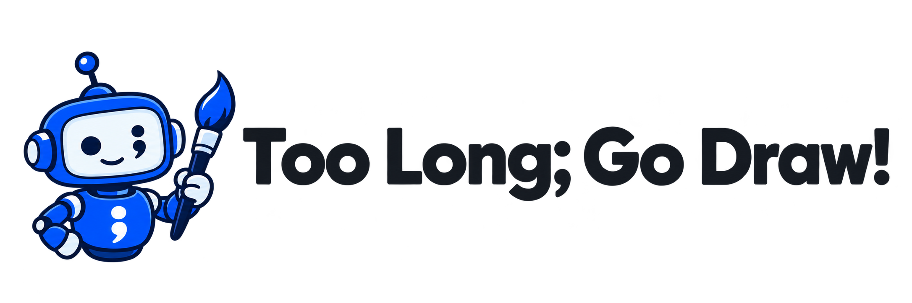
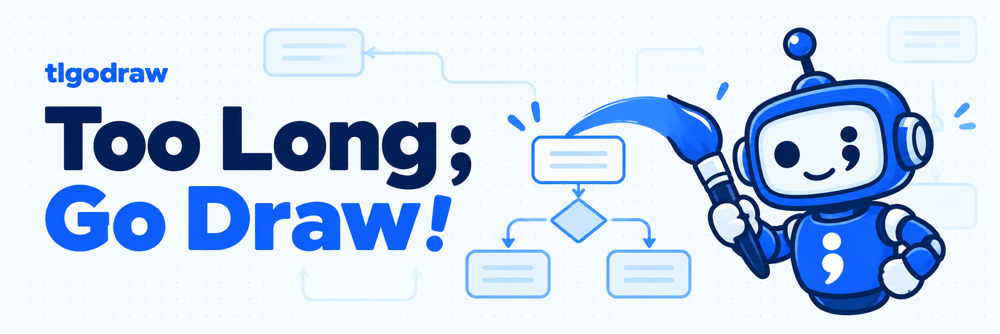

<a name="readme-top"></a>

<p align="center">
  <a href="https://tlgodraw.onrender.com">
  
  </a>
</p>

<div align="center">

**Too Long; Go Draw** 是一个 AI 辅助绘图工作台。通过自然语言描述图表，与 AI 智能体协作，在浏览器中创建或完善 Draw.io 图表。

项目包含基于 **Go/Gin** 的 API 服务和 **React** 前端。默认 AI 工作流会分析需求、生成 Draw.io XML，并在将结果返回工作台之前进行审查。

[English](./README.md) · **简体中文** · [日本語](./README.ja.md) · [官方网站](https://tlgodraw.onrender.com) · [反馈](https://github.com/yydrowz3/tlgodraw/issues)

</div>

<p align="center">
  <a href="https://tlgodraw.onrender.com">
  
  </a>
</p>

<p align="center">
  <a href="https://tlgodraw.onrender.com">
  
  </a>
</p>

<p align="center">


</p>

<p align="center">


</p>

<div align="center">

<sup>Too Long; Go Draw!</sup>

</div>

## ✨ 功能特性

- 通过自然语言生成图表。
- 在浏览器中编辑 Draw.io 图表。
- 借助 AI 分析、生成和审查图表。
- 支持多个本地绘图与聊天会话。
- 在本地环境中持久化保存会话。
- 可配置兼容 OpenAI 的 API 设置和智能体工作流。

## 📁 项目结构

```text
apps/
  api/       Go 后端服务
  web/       React 前端应用
```

API 配置位于 `apps/api/configs/application.yaml`，智能体工作流配置位于 `apps/api/configs/agent/draw.yaml`。

## 🚀 部署

### 环境要求

- Go 1.27.1 或兼容版本。
- Node.js 和 pnpm。
- 用于 AI 图表生成的兼容 OpenAI 的 API。
- 默认本地配置下，PostgreSQL 和 Redis 为可选依赖，仅在相应应用功能需要时启用。

### 配置

从 `apps/api` 目录启动时，API 默认加载 `configs/application.yaml`。也支持以下环境变量：

- `APP_CONFIG`：应用 YAML 配置文件的路径。
- `APP_ENV_FILE`：dotenv 文件的路径。设为空值可跳过 dotenv 加载。

默认智能体配置需要以下环境变量：

- `OPENAI_BASE_URL`：兼容 OpenAI 的 API 基础 URL。
- `OPENAI_API_KEY`：所配置 AI 服务提供商的 API 密钥。

开发时，在 `apps/api` 中创建本地 `.env` 文件来保存配置值。请勿提交真实凭据或其他敏感信息。

默认 API 地址为 `http://localhost:8091`。前端通过 `VITE_BASE_URL` 读取 API 基础 URL，例如：

```dotenv
VITE_BASE_URL=http://localhost:8091
```

### 本地运行

#### 启动 API

从仓库根目录执行：

```bash
cd apps/api
go run ./cmd/server
```

服务默认监听 `:8091`。如需使用自定义配置路径：

```bash
go run ./cmd/server --env .env --config configs/application.yaml
```

#### 启动 Web 应用

在另一个终端中执行：

```bash
cd apps/web
pnpm install
pnpm dev
```

打开 Vite 输出的本地 URL。确保 `VITE_BASE_URL` 指向正在运行的 API 服务。

#### 开发检查

在 `apps/api` 目录中执行后端检查：

```bash
go test ./...
go vet ./...
```

在 `apps/web` 目录中执行前端检查：

```bash
pnpm lint
pnpm build
```

### API 概览

前端通过 API 执行以下操作：

- `GET /query-ai-agent-config-list`：获取可用 AI 智能体列表。
- `POST /create_session`：创建 AI 会话。
- `POST /chat`：发送消息并接收 AI 回复。

请求成功时，API 会返回统一封装的响应，其中成功码为 `0000`。

## 🤝 参与贡献

欢迎各种形式的贡献！如果你有兴趣贡献代码，可以查看 GitHub [Issues](https://github.com/yydrowz3/tlgodraw/issues)。

请阅读 [CONTRIBUTING.md](CONTRIBUTING.md)，了解开发约定、本地检查、提交消息规范和 Pull Request 要求。

社区行为准则请参阅 [CODE_OF_CONDUCT.md](CODE_OF_CONDUCT.md)。安全问题报告方式请参阅 [SECURITY.md](SECURITY.md)。

> [!TIP]
>
> 我们正在打造一个技术驱动的交流社区，通过知识分享与观点交流，激发彼此的灵感，推动协作创新。
>
> 欢迎直接向我们提供产品设计反馈，参与用户体验讨论，帮助我们持续改进。
>
> **主要维护者：** [@yydrowz3](https://github.com/yydrowz3)

## ❤️ 赞助

每一份支持都弥足珍贵。你的一次性捐赠就像划过夜空的流星，为我们的旅程带来明亮而直接的帮助。感谢你的信任与慷慨，让我们一步步向目标迈进。

## 📄 许可证

本项目采用 `MIT License`，详情请参阅 [LICENSE](LICENSE)。

版权所有 © 2026 [Feed To Go](https://github.com/yydrowz3/tlgodraw)。

<div align="right">

[](#readme-top)

</div>

---

_祝你享受构建智能体的乐趣！_
